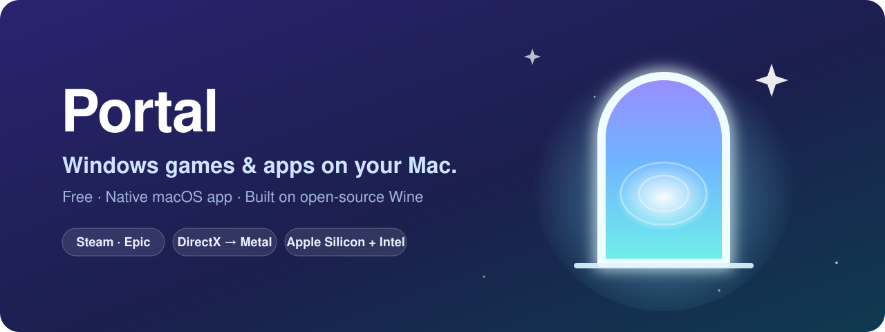
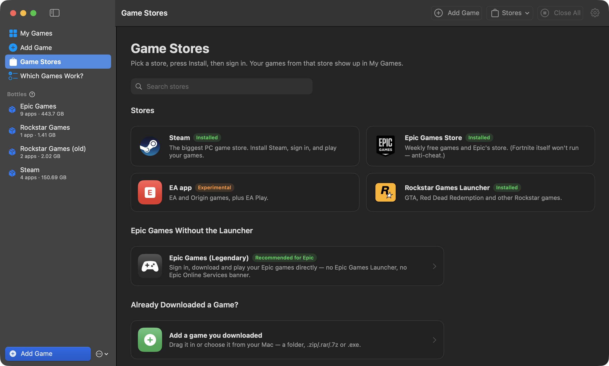
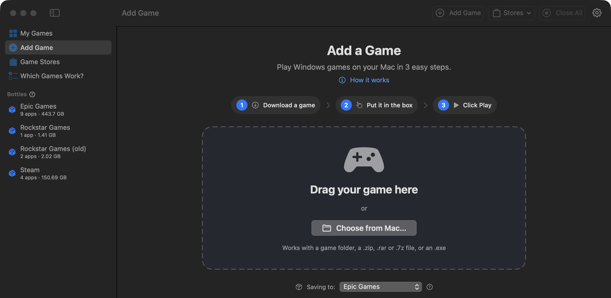
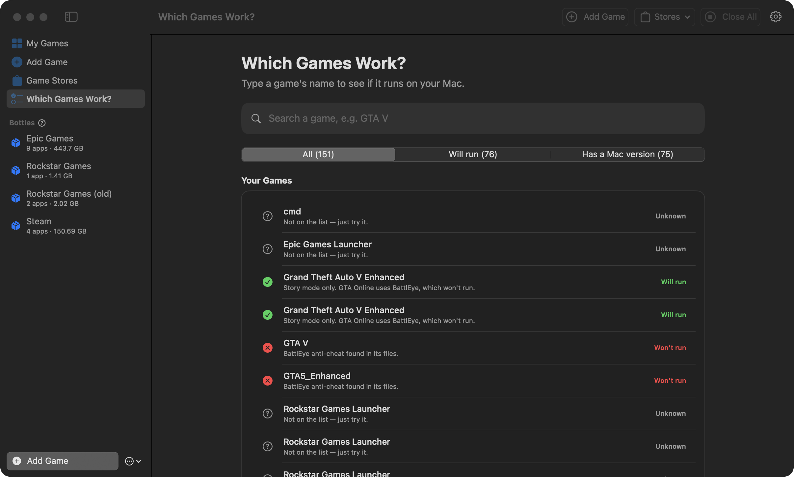
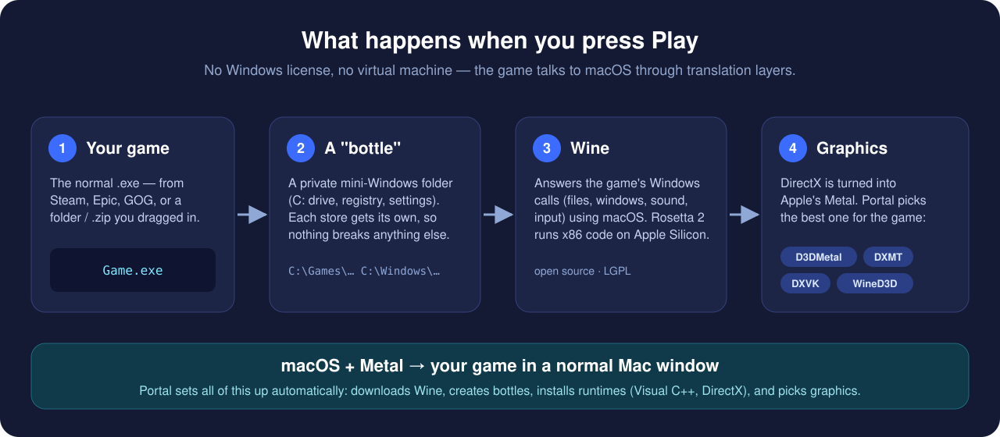
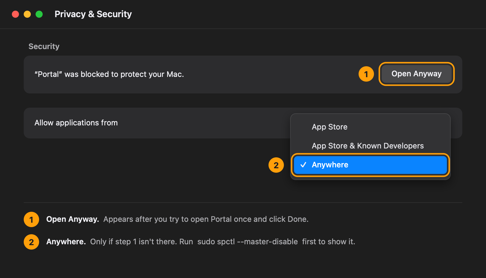

<p align="center">
  
</p>

<p align="center">
  <a href="https://github.com/harjotsingh77/portal/releases/latest/download/Portal.dmg">
    
  </a>
</p>

<p align="center">
  <a href="https://github.com/harjotsingh77/portal/releases/latest"></a>
  
  
  <a href="https://github.com/harjotsingh77/portal/releases"></a>
</p>

---

**Portal** is a free Mac app that runs Windows games and programs. It sets up everything for you: Wine,
graphics translation, runtimes and game stores. You don't need a Windows license, a virtual machine or any
Terminal commands.

<p align="center">
  
</p>

## Install in 1 minute

**Fastest:** paste this into Terminal. It installs Portal and opens it with no security warning:

```bash
curl -fsSL https://raw.githubusercontent.com/harjotsingh77/portal/main/install.sh | bash
```

**Or download the DMG:**

1. **[Download Portal.dmg](https://github.com/harjotsingh77/portal/releases/latest/download/Portal.dmg)**.
2. Open the DMG and drag **Portal** into **Applications**.
3. Open Portal. The first time, macOS shows a warning because Portal isn't from the App Store
   ([how to open it](#macos-says-apple-could-not-verify-portal)).
4. Finish the short setup. Portal downloads Wine and the other pieces it needs (one time only).

## Play a game in 3 steps

<p align="center">
  
</p>

| | |
|---|---|
| **1. Get the game** | Use a store from **Game Stores** (Steam, Epic, EA app, Rockstar), or use a game you already downloaded. |
| **2. Put it in Portal** | Drag the game folder, `.zip`, `.rar`, `.7z` or `.exe` onto **Add Game**. Installers (`setup.exe`, `.msi`) run automatically. |
| **3. Click Play** | The game appears in **My Games**. Next time, just click its poster. |

**Epic games without the Epic launcher:** go to *Game Stores → Epic Games (Legendary)*, sign in on Epic's own
page, then install and play. Your password goes only to Epic.

## Will my game work?

<p align="center">
  
</p>

Open **Which Games Work?** and type the game's name. Portal also checks a game's files before the first launch,
and it tells you plainly when a game won't run:

- ✅ **Most single-player DirectX 9, 10 and 11 games** run well.
- ⚠️ **DirectX 12 games** need Apple's free [Game Porting Toolkit](https://developer.apple.com/games/game-porting-toolkit/).
  Portal shows you how to add it, step by step.
- ❌ **Games with kernel anti-cheat** (Valorant, Fortnite, most online shooters, GTA Online) don't run. No Mac tool can run them.

## How it works

<p align="center">
  
</p>

- **Bottles.** Each store or game gets its own small, private Windows folder with its own `C:` drive, registry
  and settings. If one bottle breaks, the others keep working. You can snapshot, back up or delete a bottle.
- **Wine** is an open-source program that answers a game's Windows requests (files, windows, sound,
  controllers) using macOS. It is not an emulator and it doesn't need Windows. On Apple Silicon, Apple's
  Rosetta 2 runs the game's Intel code.
- **Graphics.** Games use Microsoft's DirectX, and Macs use Apple's Metal. Portal picks a translator for each game:
  **D3DMetal** (Apple, DirectX 11/12), **DXMT** (DirectX 10/11), **DXVK** (DirectX 9–11 through MoltenVK) or
  **WineD3D**. Use **Benchmark** in Power Tools to compare them.
- **Automatic fixes.** Portal reads the game's files and installs missing Visual C++, DirectX and PhysX runtimes.
  It starts the game's launcher (Steam, EA, Rockstar) first when the game needs one. If a game crashes,
  **Crash Doctor** reads the log and suggests a fix.

## Features

| | |
|---|---|
| 🎮 **Game Stores** | One-click setup for Steam, Epic Games Store, EA app and Rockstar Games Launcher. |
| 📦 **Drag and drop** | Folders, archives, `.exe` and installers. Portal finds the right `.exe` for you. |
| 🖼️ **Library** | Cover art for every installed game from every store, in one place. |
| 🩺 **Crash Doctor** | Reads crash logs and explains what went wrong in plain words. |
| ⚡ **Power Tools** | Graphics backend benchmark, performance overlay, shader cache, save-game backups and bottle snapshots. |
| 🕹️ **Controllers** | Xbox, PlayStation and other controllers work in games. |
| 🚀 **Mac shortcuts** | Put any game in Launchpad or the Dock like a normal Mac app. |
| ⌨️ **Command line** | `portal run`, `portal install steam`, `portal doctor` and more (`Portal.app/Contents/Helpers/portal`). |

## FAQ

### macOS says "Apple could not verify Portal"

Portal is free and isn't sold through the App Store, so Apple hasn't checked it. To open it the first time:

<p align="center">
  
</p>

1. Try to open Portal once and click **Done** on the warning. Don't click *Move to Bin*.
2. Open **System Settings → Privacy & Security**.
3. Scroll down and click **Open Anyway** next to *"Portal" was blocked*. Then confirm with your password.

You only need to do this once. The Terminal installer above avoids it entirely.

Or run this once in Terminal:

```bash
xattr -dr com.apple.quarantine /Applications/Portal.app
```

#### Still blocked? Allow apps from "Anywhere"

On newer macOS versions the **Anywhere** option is hidden. Show it once, then pick it:

1. Open **Terminal** and run this (it asks for your Mac password; nothing appears as you type):

   ```bash
   sudo spctl --master-disable
   ```

2. Open **System Settings → Privacy & Security** and scroll down to **Security**.
3. Under **Allow applications from**, choose **Anywhere** and confirm with your password.
4. Open Portal again. It opens normally now.

> **Note:** "Anywhere" lets *every* app open without Apple's check, not only Portal. Once Portal opens,
> you can switch back to **App Store & Known Developers** and Portal keeps working. To turn the check
> back on from Terminal: `sudo spctl --master-enable`

### Which Macs are supported?

Any Mac with **macOS 14 Sonoma or later**. Portal is a universal app for Apple Silicon (M1–M5) and Intel Macs.
Games run fastest on Apple Silicon. D3DMetal (for DirectX 12) needs Apple Silicon.

### Is it safe? Where are my files?

Windows programs run only inside their bottle. Everything Portal stores is in
`~/Library/Application Support/Portal`. Downloaded engines and graphics libraries are checked with SHA-256
before use. To uninstall, delete Portal from Applications and delete that folder.

### Does it cost anything?

No. Portal is free.

### A game doesn't start. What now?

Open the game's bottle, click **Logs**, and read Crash Doctor's suggestion. You can also try a different
graphics backend in the bottle's **Settings**. To report a problem, open an
[issue](https://github.com/harjotsingh77/portal/issues) with the game's name, your Mac model and the log.

## Credits

Portal is built on these open-source projects. Each keeps its own license (see [`LICENSES/`](LICENSES)):

- [Wine](https://www.winehq.org) (LGPL 2.1), using the macOS builds by [Gcenx](https://github.com/Gcenx/macOS_Wine_builds)
- [DXVK](https://github.com/doitsujin/dxvk) (zlib) and [MoltenVK](https://github.com/KhronosGroup/MoltenVK) (Apache 2.0)
- [DXMT](https://github.com/3Shain/dxmt) (MIT)
- [winetricks](https://github.com/Winetricks/winetricks) and cabextract (GPL)
- [Legendary](https://github.com/derrod/legendary) (GPL 3.0) for Epic Games

D3DMetal is part of Apple's Game Porting Toolkit. Portal doesn't include it; you add it yourself from Apple.

Portal isn't affiliated with Microsoft, Valve, Epic Games, Apple, CodeWeavers or any game publisher. Game names
and logos belong to their owners.
